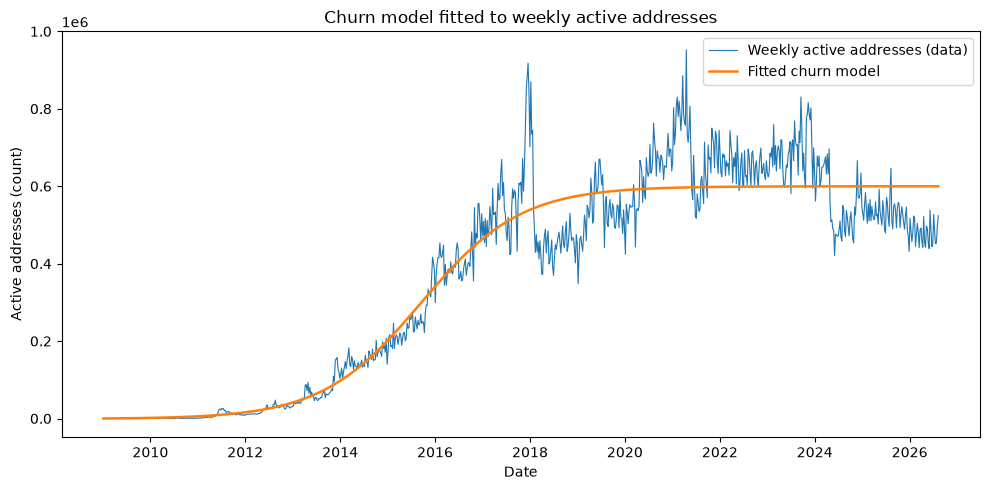

# Bitcoin Adoption as a Diffusion Process

Fits a Bass diffusion model, extended with user churn, to 17 years of Bitcoin active-address data. The model is solved symbolically and numerically, and a bootstrap shows which quantities the data actually pins down.

Notebook: [bitcoin_adoption_diffusion.ipynb](bitcoin_adoption_diffusion.ipynb). Outputs are saved, so it reads on GitHub without running.

## Problem

Bitcoin's user base grew with no company marketing it and no coordinated launch. The Bass model separates adoption into two forces: innovation (people who adopt independently, rate *p*) and imitation (people pulled in by existing users, rate *q*). Does that structure describe Bitcoin's growth, and which force dominated?

## Approach

- **Model.** Derived from first principles: dA/dt = (p + qA/m)(m − A). It is then extended with a churn term −dA, because active users can go dormant, so the network settles below its nominal ceiling *m*.
- **Exact solutions.** Closed forms come from SymPy. For the churn model, `dsolve` fails on the initial condition, so the solution is derived by hand and verified symbolically: the residual simplifies to 0, and it agrees with `solve_ivp` to within 1e-7.
- **Calibration.** Blockchain.com's unique-addresses series is irregularly spaced, so it is resampled to a weekly grid. *p*, *q*, *m* and *d* are fitted by non-linear least squares (`scipy.optimize.curve_fit`).
- **Uncertainty.** A bootstrap (200 resamples of the weekly observations, each refitted) gives 95% intervals for every parameter and for the long-run equilibrium.
- **Numerical methods.** Euler and Heun schemes are implemented from scratch and scored against the exact solution.
- **Interactive exploration.** Sliders (ipywidgets) show how each parameter shapes the curve.

## Results



| Quantity | Estimate | 95% bootstrap CI |
|---|---|---|
| Innovation rate *p* (per day) | 7.65e-7 | [5.15e-7, 9.89e-7] |
| Imitation rate *q* (per day) | 0.0149 | [0.0148, 0.0155] |
| Churn rate *d* (per day) | 0.0123 | [0.0123, 0.0127] |
| Long-run active addresses | 599,805 | [589,600, 613,000] |

- The fit is good: R² = 0.914, with a mean absolute error of about 53,000 addresses against the weekly series.
- Growth was almost entirely imitation-driven. *q* is about 20,000 times *p*.
- Individual parameters are weakly identified: very different values of *m* give almost the same curve. The long-run equilibrium of about 600,000 weekly active addresses is the quantity the data constrains tightly, with a bootstrap interval of ±2%.
- Heun's method is about 15 times more accurate than Euler at the same step size: mean absolute error 103 addresses versus 1,529.

## Tech stack

Python, SymPy, SciPy (`curve_fit`, `solve_ivp`), NumPy, pandas, matplotlib, ipywidgets, Jupyter.

## How to run

```bash
git clone https://github.com/OlisaAsielue/bitcoin-adoption-diffusion.git
cd bitcoin-adoption-diffusion
python -m venv venv && source venv/bin/activate
pip install -r requirements.txt
jupyter notebook bitcoin_adoption_diffusion.ipynb
```

The data file `data/n-unique-addresses.json` is included (export from [blockchain.com/charts/n-unique-addresses](https://www.blockchain.com/charts/n-unique-addresses), accessed 1 August 2026).

## Limitations and next steps

- Unique addresses are a proxy for users. One person can control many addresses, and exchanges pool many users into few.
- *p*, *q* and *d* are held constant across 17 years, so the model captures the average level after 2018 but not the cycles around halvings or the 2024 ETF approval. A piecewise or time-varying fit would test whether those events shifted the parameters.
- Weekly averaging removes structure shorter than a week.
